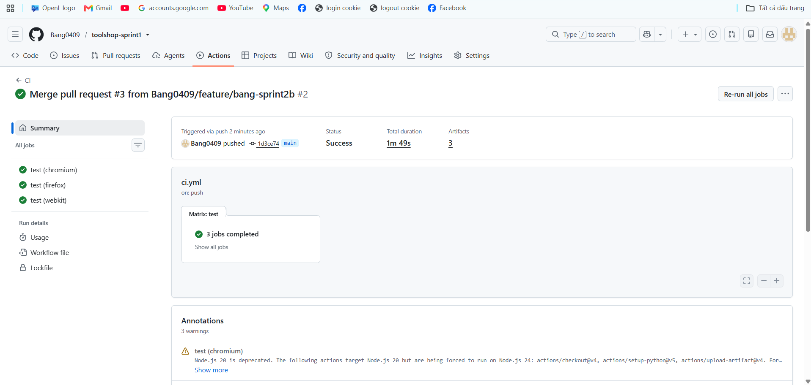
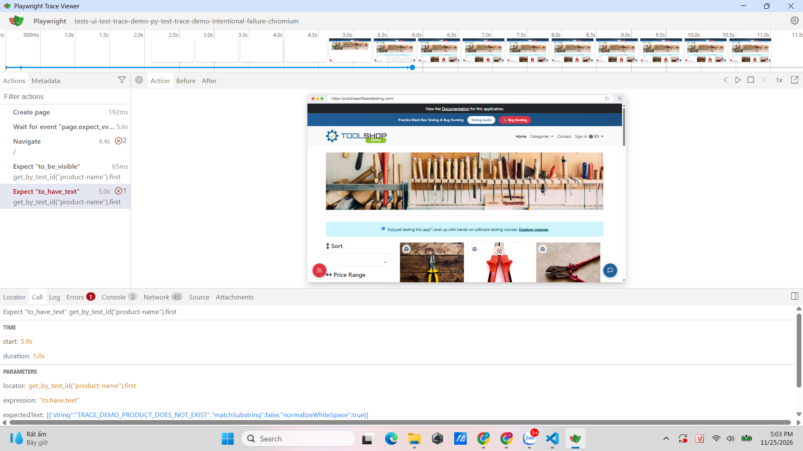

# toolshop-sprint1
Toolshop Automation Testing - Sprint 1

---

## Trạng thái GitHub Actions

## Kết quả CI

Hệ thống kiểm thử tự động bằng GitHub Actions với ba trình duyệt:

- Chromium
- Firefox
- WebKit

Kết quả: Cả 3 job CI chạy thành công trên nhánh `main`.

## Trace Viewer

Playwright Trace Viewer giúp phân tích các bài kiểm thử thất bại thông qua lịch sử thao tác, ảnh chụp giao diện và thông tin lỗi.

Ảnh dưới đây minh họa một bài kiểm thử thất bại có chủ đích nhằm kiểm tra khả năng lưu và phân tích trace. Bài kiểm thử minh họa không thuộc bộ kiểm thử chính thức.

